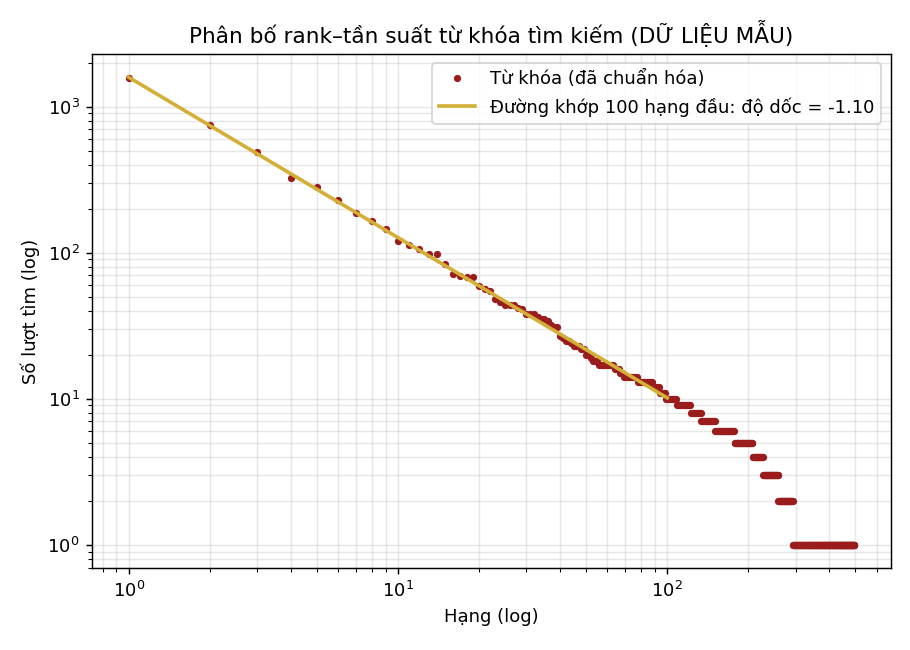

# Tóm tắt dữ liệu mô phỏng (seed 42)

Mọi dòng có `du_lieu_mau = true`.

| Bảng | Số dòng |
|---|---:|
| tai_lieu | 3400 |
| ma_van_de | 29 |
| ban_sao | 5817 |
| nguoi_dung | 63 |
| luot_muon | 400 |
| log_tim_kiem | 8000 |

- Tỉ lệ lượt tìm 0 kết quả: **12.1%**
- Tỉ lệ log có `tai_lieu_chon_id`: **41.5%**
- Độ dốc log-log 100 hạng đầu: **-1.10** (Zipf s≈1.1 → độ dốc ≈ -1.1; lệch do gộp biến thể không dấu và lỗi gõ)

## Lượt mượn theo trạng thái

| Trạng thái | Số |
|---|---:|
| cho_duyet | 12 |
| da_tra | 314 |
| dang_muon | 43 |
| tu_choi | 31 |

## Top 10 từ khóa

| # | Từ khóa | Lượt |
|---:|---|---:|
| 1 | lưu trữ | 1572 |
| 2 | tài liệu | 743 |
| 3 | công tác | 491 |
| 4 | python | 326 |
| 5 | việt nam | 281 |
| 6 | tổ chức | 229 |
| 7 | văn phòng | 187 |
| 8 | blockchain | 164 |
| 9 | quản lý | 146 |
| 10 | hoạt động | 121 |

